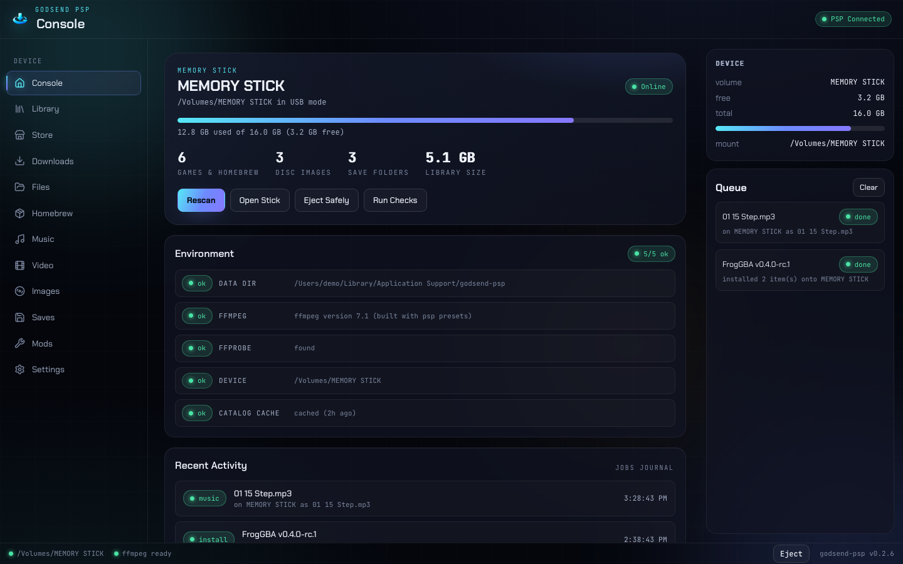
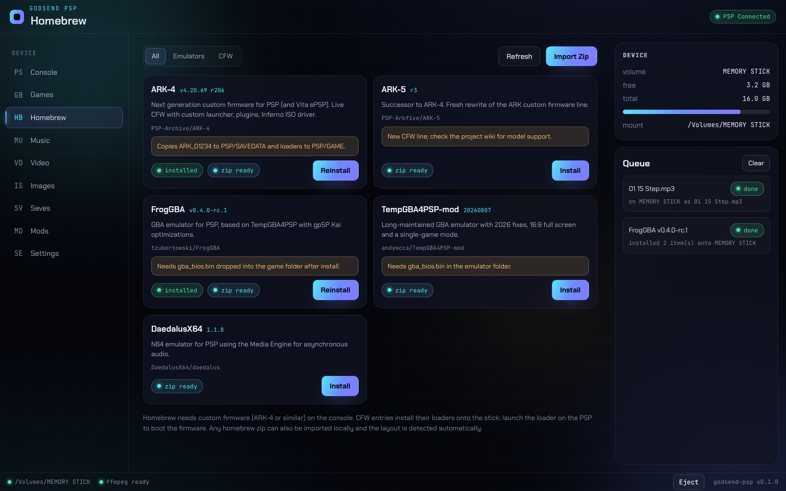

# GODsend PSP

[](https://ghostyshell.github.io/godsend-psp/)
[](https://discord.gg/d3sFnrgpJn)
[](https://ko-fi.com/ghosty99)
[](https://etherscan.io/address/0xbBef115aD853236a350EaF04777a2AdB2e7c0317)

A desktop workshop for the PSP: plug the console in over USB and manage
everything on the memory stick from one window. Built with a Rust engine,
Tauri 2 and React.

| Console | Homebrew |
| --- | --- |
|  |  |


[Watch the video guides](https://ghostyshell.github.io/godsend-psp/video-guides.html) - one short recording per tab.

## Download

<!-- downloads:start -->
| Build | GoFile (primary) | file.kiwi (backup) | Size |
| --- | --- | --- | --- |
| `godsend-psp-0.2.51-linux-x64.AppImage` | [Download](https://gofile.io/d/rrw5ocug) | [Mirror](https://file.kiwi/3e7bc0e6#YiYhWKTFcFmVdtpyMQq55Q) | 132.0 MiB |
| `godsend-psp-cli-0.2.51-linux-x64.tar.gz` | [Download](https://gofile.io/d/5uFVZHDZ) | [Mirror](https://file.kiwi/1fae6cbd#gKzyfbtadsFmgmw8QxWU8g) | 2.1 MiB |
| `godsend-psp-cli-0.2.51-macos-arm64.tar.gz` | [Download](https://gofile.io/d/z1zR0jbz) | [Mirror](https://file.kiwi/4681c4eb#duGcAR4wKtCGp190IK3g5w) | 1.9 MiB |
| `godsend-psp-cli-0.2.51-macos-x64.tar.gz` | [Download](https://gofile.io/d/0eA7oCDD) | [Mirror](https://file.kiwi/fa6ddd77#ZmS1rRiLEQqM0KcZq1Hmiw) | 2.0 MiB |
| `godsend-psp-cli-0.2.51-windows-x64.zip` | [Download](https://gofile.io/d/UVepxKPK) | [Mirror](https://file.kiwi/3f3a4cf6#H0us6SgByB7XwjzcfogOvA) | 2.1 MiB |
| `linux-x64.zip` | [Download](https://gofile.io/d/pn4k4IDx) | [Mirror](https://file.kiwi/087d9b7f#saJ67NPA8gtoSK7027M2gg) | 196.1 MiB |
| `macos-arm64.zip` | [Download](https://gofile.io/d/8effg61D) | [Mirror](https://file.kiwi/da4ac09e#NbyHDbKAeWORmqwbUqFrCA) | 46.2 MiB |
| `macos-x64.zip` | [Download](https://gofile.io/d/hZPKaqPQ) | [Mirror](https://file.kiwi/f5d75196#R4TpS3yxJNsCJFJLkPtC4Q) | 61.0 MiB |
| `godsend-psp-0.2.51-linux-x64.deb` | [Download](https://gofile.io/d/u3bOP8Dd) | [Mirror](https://file.kiwi/b10afe67#NgqBMhr54G9i1PP82Izqow) | 62.8 MiB |
| `godsend-psp-0.2.51-arm64.dmg` | [Download](https://gofile.io/d/EstqVBb6) | [Mirror](https://file.kiwi/b55f1099#OtojIYkFjJCMKqEQX1jlbw) | 44.4 MiB |
| `godsend-psp-0.2.51-x64.dmg` | [Download](https://gofile.io/d/KiA0Jnrh) | [Mirror](https://file.kiwi/4eb3db4f#vSylia5NdqrIRvnhRkYjjw) | 59.3 MiB |
| `godsend-psp-0.2.51-x64-setup.exe` | [Download](https://gofile.io/d/Ykn151Z2) | [Mirror](https://file.kiwi/a0cfb776#n5DoUoqgMx_ESASjsdWJvw) | 45.1 MiB |
<!-- downloads:end -->

**GoFile** is the primary host and **file.kiwi** is the encrypted backup. Links
are refreshed weekly by
`scripts/refresh-release-links.sh` (launchd, Sundays 03:47) because GoFile
expires free-tier files. The desktop builds are not notarized: right-click,
Open, Open on first launch (or
`xattr -dr com.apple.quarantine "/Applications/GODsend PSP.app"`).
CI still builds every platform on each `v*` tag; the publish script pulls
those artifacts and uploads them.

## Guides

Step-by-step walkthroughs live in [docs/guides](docs/guides/index.md):

1. [Connect your PSP](docs/guides/connect-your-psp.md)
2. [Homebrew and custom firmware](docs/guides/homebrew-and-cfw.md)
3. [Music and video](docs/guides/music-and-video.md)
4. [Disc images](docs/guides/disc-images.md)
5. [Saves and mods](docs/guides/saves-and-mods.md)
6. [Troubleshooting](docs/guides/troubleshooting.md)
7. [Build from source](docs/guides/build-from-source.md)

## What it does

- **Game library**: scans PSP/GAME and the ISO folder, parses PARAM.SFO and
  PBP headers for titles and serial ids, shows ICON0 cover art in a grid,
  with digital / homebrew / loader filtering and inline delete.
- **Homebrew**: bundled catalog of GitHub hosted releases (ARK-4, ARK-5,
  FrogGBA, TempGBA4PSP-mod, DaedalusX64) with smart layout detection:
  ARK folders go to PSP/SAVEDATA, EBOOT folders go to PSP/GAME, archives
  with a PSP/ tree merge at the stick root. Any local zip imports the same
  way. AppleDouble junk (._ files, __MACOSX) is pruned automatically.
- **Music and video**: push into PSP/MUSIC and PSP/VIDEO. ffmpeg converts
  anything to PSP formats (MP3/M4A audio, AVC 480x272 MP4 video) with live
  progress; already-compatible files copy straight through. Optional .THM
  thumbnails for videos.
- **Disc images**: ISO to CSO and CSO to ISO conversion in pure Rust, plus
  ISO import with on-the-fly compression. UMD titles and serial ids are
  read straight out of the ISO9660 tree.
- **Save data**: lists PSP/SAVEDATA with save titles from each PARAM.SFO,
  backs up saves to zip, restores them, never touches CFW payload folders.
- **Mods**: seplugins manager (game.txt / vsh.txt / pops.txt with toggles),
  XMB theme installer (.ptf / .ctf into PSP/THEME), and one-click CFW
  installers for ARK-4 and ARK-5.
- **No drivers**: the PSP in USB mode is plain mass storage. Detection is
  filesystem based on macOS, Windows and Linux.

## Download

Installers and portable builds for macOS (arm64, x64), Windows (NSIS setup,
portable) and Linux (AppImage, deb, tarball) are published per release.
The headless CLI ships alongside every build.

## Build from source

Requirements: Rust 1.85+, Node 20+, and the Tauri 2 prerequisites for your
platform (Xcode CLT on macOS, MSVC + WebView2 on Windows, webkit2gtk-4.1
on Linux). The full walkthrough is in
[docs/guides/build-from-source.md](docs/guides/build-from-source.md).

```sh
npm install --prefix app
npx --prefix app tauri icon app/src-tauri/icons/icon.png   # once
cargo build --release -p godsend-psp-cli                   # CLI
npx --prefix app tauri build                               # desktop bundles
```

Dev without hardware:

```sh
npm run --prefix app dev:mock    # UI with a fixture memory stick (?mock=1)
```

CLI quick tour:

```sh
godsend-psp devices                       # list volumes, flag PSP ones
godsend-psp scan                          # games + disc images
godsend-psp catalog --refresh             # fetch latest release tags
godsend-psp catalog-install froggba       # install an emulator
godsend-psp install ~/Downloads/hb.zip    # import any homebrew zip
godsend-psp music ~/Music/album/*.mp3     # push + convert
godsend-psp video ~/Movies/film.mkv --thm # push + convert + thumbnail
godsend-psp convert image.iso             # ISO <-> CSO
godsend-psp saves backup --out saves.zip  # zip all saves
godsend-psp plugins list                  # seplugins state
godsend-psp doctor                        # environment checks
godsend-psp mcp                           # loopback MCP server on 127.0.0.1:8849
```

## Platform notes

- macOS: ejects via `diskutil`, not notarized, right-click Open on first
  launch or `xattr -dr com.apple.quarantine /Applications/GODsend\ PSP.app`.
- Windows: safe eject is handled by the system tray; the app reads any
  drive letter.
- Linux: volumes under /media/$USER and /run/media/$USER.

## Architecture

```
core/            godsend-core: engine crate (device, sfo, pbp, iso, cso,
                 library, transfer, media, homebrew, plugins, themes,
                 savedata, doctor). No framework dependencies.
cli/             godsend-psp headless CLI (clap).
app/             Tauri 2 desktop app: React 18 + TypeScript frontend,
                 ~40 commands in app/src-tauri, events for job progress
                 and device changes.
```

See [DESIGN.md](DESIGN.md) for the design system and
[docs/features.md](docs/features.md) for the feature reference.

## License

MIT.
